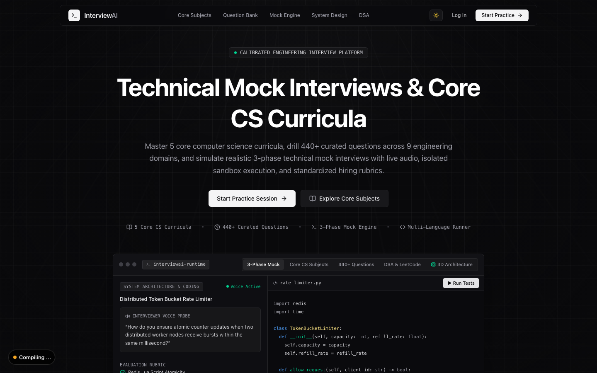
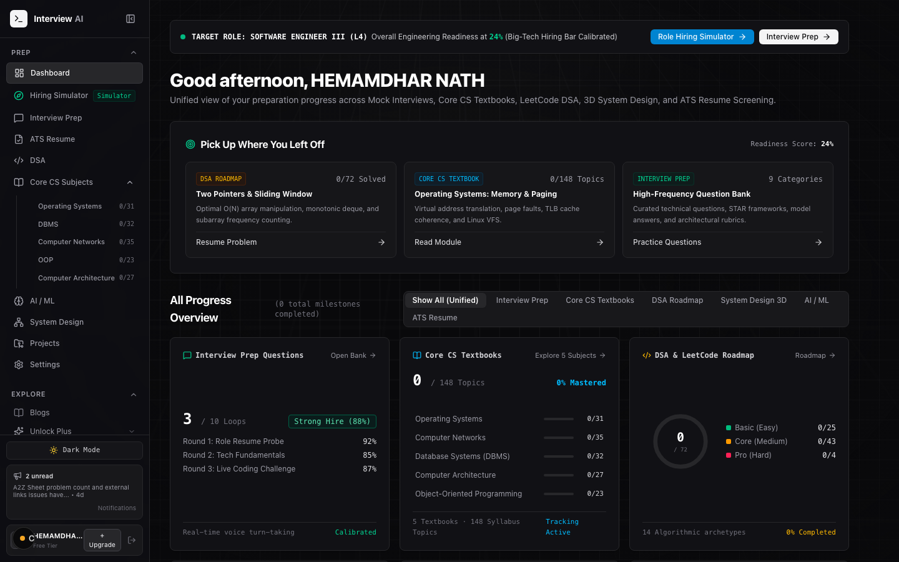
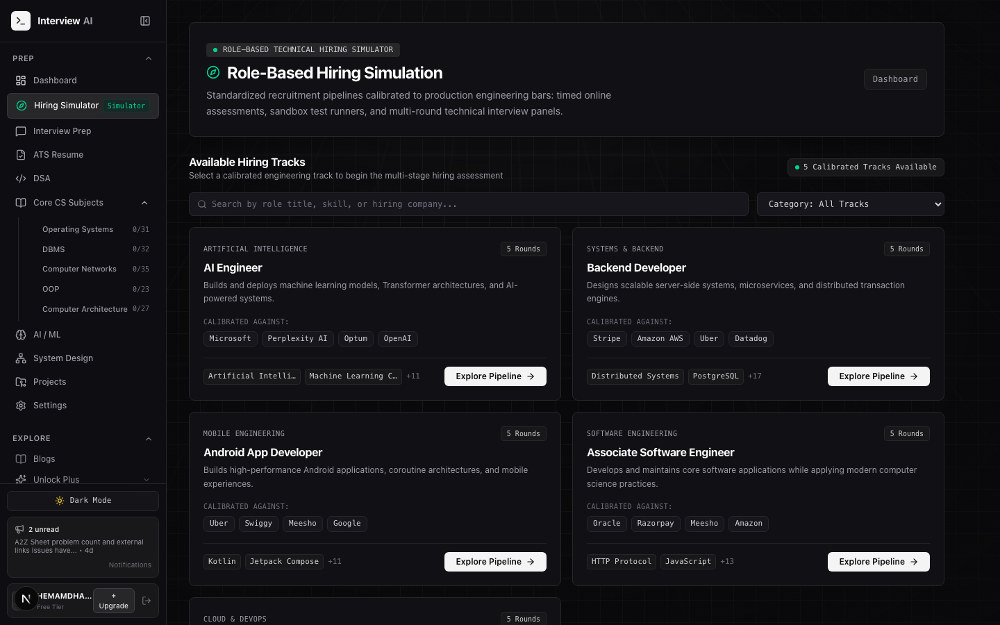
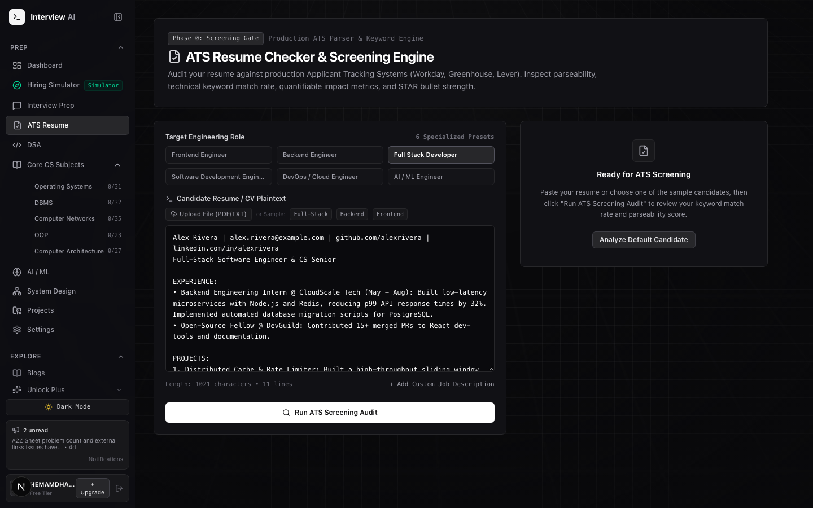
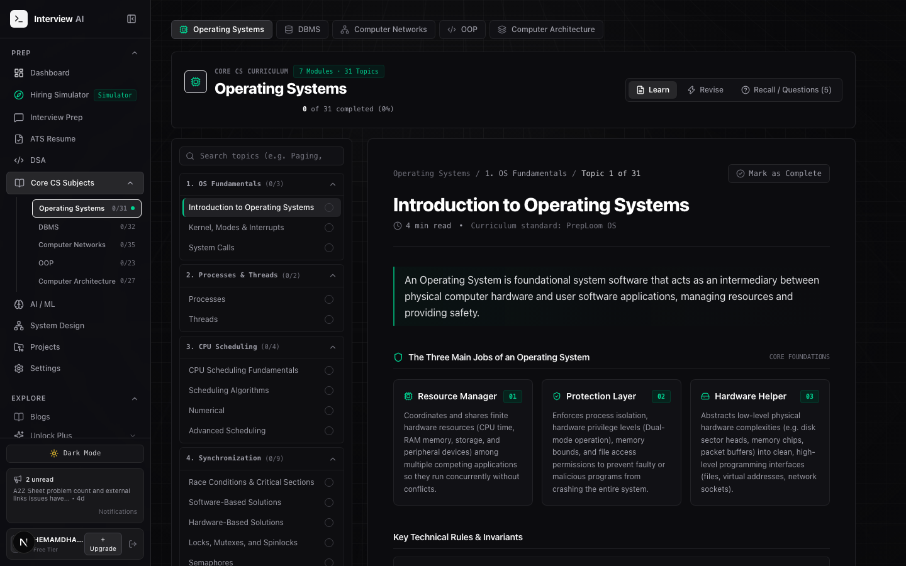
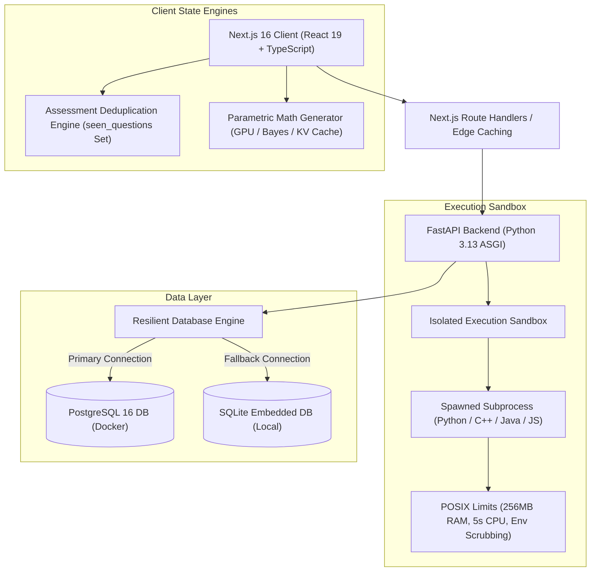

# AI Mock Interview & Engineering Hiring Simulator

An enterprise-grade, full-stack technical interview preparation platform, proctored hiring simulator, and ATS resume screening system designed for software engineers. Built as an engineering capstone project utilizing Next.js 16 (React 19, TypeScript, Tailwind CSS v4), FastAPI (Python 3.13), and an isolated multi-language code execution sandbox.

---

## System Screenshots (Localhost Previews)

### 1. Landing Page & Engineering Platform Overview
Platform landing interface featuring calibrated mock interview tracks, core CS curricula roadmap links, and multi-language sandbox details.



---

### 2. Engineering Dashboard & Learning Workspace
Interactive candidate cockpit providing quick access to domain interview prep, live code execution sandbox, resume screening, and curriculum tracks.



---

### 3. Proctored Technical Online Assessment (Hiring Simulator)
Timed multi-section online assessment environment with quantitative aptitude, domain architecture questions, algorithmic sandbox challenges, and deduplicated question sampling.



---

### 4. ATS Resume Screening & Hiring Audit Engine
Resume evaluation console with real-time keyword coverage scoring, format compliance auditing, and actionable STAR bullet recommendations.



---

### 5. Core Computer Science Curricula & Subject Mastery
Comprehensive syllabus navigation covering 148 verified topics across Operating Systems, DBMS, Computer Networks, OOP, and Modern Computer Architecture with collapsible topic branches.



---

## Architectural Highlights



---

## Core System Modules

### 1. Adaptive Technical Online Assessment (Hiring Simulator)
- **Role-Calibrated Tracks**: Pre-configured evaluation tracks for AI Engineers, Backend Systems Architects, Android Leads, Cloud Architects, and Generalist SWEs.
- **Three-Section Architecture**:
  1. **Section 1: Aptitude, Reasoning & Verbal** (15 questions, 15 minutes allotted).
  2. **Section 2: Domain Concepts & DSA MCQ** (30 questions, 30 minutes allotted).
  3. **Section 3: Coding & ML Round** (2 sandbox algorithmic challenges, 45 minutes allotted).
- **Dual Synchronized Timers**: Active section countdown with low-time warning pulses and total exam duration monitoring.
- **Proctoring Integrity**: Fullscreen departure detection with violation counter and modal warnings.

### 2. Zero-Repeat Deduplication & Parametric Question Engine
- **Persistent Question Registry**: Records all presented question IDs to browser storage (`localStorage`), filtering out previously seen questions on consecutive attempts.
- **Dynamic Parametric Math Variations**: Quantifiable problems (GPU TFLOPS throughput, Bayes' Theorem data drift, KV cache memory footprint) randomize numerical parameters dynamically and calculate verified answers on the fly.
- **Multi-Attempt Capacity**: Expanded question repository (30 Section 1 questions, 60 Section 2 questions, 4 runnable coding challenges) supports multiple non-repeating assessment sessions.

### 3. Isolated Code Execution Sandbox
- **Multi-Language Execution**: Native execution support for Python 3.13, C++17, JavaScript/TypeScript, and Java.
- **POSIX Resource Ceilings**: Enforces process isolation, strict CPU execution limits (5 seconds default), 256MB memory caps, and clean process group termination (`SIGKILL`).
- **Security Scrubbing**: Static analysis filters out dangerous tokens (`os.fork`, `subprocess`, socket connections, file destruction). Environments are completely scrubbed of host credentials.
- **Deterministic Assertion Suites**: Automated test runners execute student code against hidden and public test cases, recording exact memory and runtime statistics.

### 4. ATS Resume Screener & Hiring Funnel Audit
- **Format & Parsing Validation**: Inspects section structures, bullet formatting, and character density.
- **Keyword Matrix Alignment**: Evaluates core domain stack keywords against target job descriptions.
- **Quantifiable Outcome Density**: Verifies whether bullet points include measurable outcomes (latency, scale, percentages) using the STAR methodology.

### 5. Core CS Subjects Curriculum
- **Structured Knowledge Graph**: 148 verified topics spanning 5 core disciplines:
  - Operating Systems (31 modules)
  - Database Management Systems (32 modules)
  - Computer Networks (35 modules)
  - Object-Oriented Programming (23 modules)
  - Modern Computer Architecture (27 modules)
- **Interactive Collapsible Navigation**: Persistent state toggle remembering candidate expansion preferences across sessions.

---

## Technology Stack

### Frontend Architecture
- **Framework**: Next.js 16.3.5 (Turbopack, App Router)
- **UI Library**: React 19.2.8
- **Language**: TypeScript 5
- **Styling**: Tailwind CSS v4 (Matte neutral dark design system, zero purple gradients, geometric radii)
- **Icons**: Lucide React
- **Math Rendering**: KaTeX / LaTeX formula rendering

### Backend Architecture
- **Framework**: FastAPI (Python 3.13)
- **Server**: Uvicorn (ASGI)
- **ORM & Migrations**: SQLAlchemy 2.0 with declarative models
- **Validation**: Pydantic v2
- **Testing**: Pytest with HTTPX TestClient

### Database & Infrastructure
- **Primary Database**: PostgreSQL 16 (Alpine Docker container)
- **Local Fallback**: SQLite 3 with automatic connection failover
- **Containerization**: Docker & Docker Compose

---

## Directory Structure

```text
├── backend/
│   ├── app/
│   │   ├── api/v1/          # REST route handlers (Auth, Sandbox, Simulator, Progress)
│   │   ├── core/            # Configuration, database engine, security tokens
│   │   ├── models/          # SQLAlchemy relational schemas (User, Interview, Progress)
│   │   ├── schemas/         # Pydantic request and response schemas
│   │   ├── services/        # Isolated sandbox runner & subprocess execution
│   │   └── main.py          # FastAPI application entry point & CORS configuration
│   ├── tests/               # Backend integration and security test suite
│   ├── requirements.txt     # Python dependencies
│   └── pytest.ini           # Pytest configuration
├── frontend/
│   ├── src/
│   │   ├── app/             # Next.js 16 App Router (Dashboard, Login, Subjects, ATS)
│   │   ├── components/      # UI components (HiringSimulator, Sidebar, Sandbox, ATS)
│   │   ├── context/         # React Context providers (AuthContext)
│   │   ├── data/            # Curated question banks & calibrated hiring track rubrics
│   │   └── lib/             # Assessment deduplication engine & progress tracking
│   ├── package.json         # Frontend dependencies and Turbopack scripts
│   └── next.config.ts       # Next.js configuration with worker thread optimizations
├── docs/
│   └── screenshots/         # Interface previews for documentation
├── docker-compose.yml       # PostgreSQL 16 service definition
├── AGENTS.md                # Design manifesto & craft guidelines
└── README.md                # Project documentation
```

---

## Getting Started

### Prerequisites
- **Node.js**: v20.x or higher
- **Python**: v3.11 or higher (Python 3.13 recommended)
- **Docker**: For running PostgreSQL (optional; falls back to SQLite automatically)

---

### Step 1: Clone the Repository
```bash
git clone <repository-url>
cd AI-Mock-Interview
```

---

### Step 2: Database Setup (Optional Docker)
To start the containerized PostgreSQL 16 database:
```bash
docker compose up -d
```
*Note: If Docker is not running, the backend automatically falls back to an embedded SQLite database (`backend/interview_ai.db`).*

---

### Step 3: Backend Setup
```bash
cd backend

# Create and activate Python virtual environment
python3 -m venv venv
source venv/bin/activate

# Install dependencies
pip install -r requirements.txt

# Run backend development server
uvicorn app.main:app --reload --port 8000
```
The FastAPI documentation will be available at `http://localhost:8000/docs`.

---

### Step 4: Frontend Setup
Open a new terminal window:
```bash
cd frontend

# Install dependencies
npm install

# Run Next.js development server
npm run dev
```
The web application will be accessible at `http://localhost:3000`.

---

## Verification & Testing

### Running Frontend Production Build
```bash
cd frontend
npm run build
```
Confirms static generation across all 30 routes with 0 TypeScript or linting errors.

### Running Backend Pytest Suite
```bash
cd backend
source venv/bin/activate
pytest tests/
```
Runs test cases covering authentication, sandbox security, execution isolation, and assessment history persistence.

---

## API Reference Summary

| Method | Endpoint | Description |
| :--- | :--- | :--- |
| `POST` | `/api/v1/auth/signup` | Register a new engineer account |
| `POST` | `/api/v1/auth/login` | Authenticate candidate and receive JWT token |
| `GET` | `/api/v1/auth/me` | Fetch authenticated user profile |
| `POST` | `/api/v1/compile/run` | Execute code in the isolated subprocess sandbox |
| `POST` | `/api/v1/compile/test` | Run code against an automated test case suite |
| `POST` | `/api/simulator/submit` | Record completed assessment scores & diagnostic scorecard |
| `GET` | `/api/simulator/history` | Retrieve historical assessment attempts and verdicts |
| `POST` | `/api/ats/evaluate` | Audit resume text against ATS scoring criteria |

---

## Design & Engineering Philosophy

This project adheres to the **KrishanuBuilds Design Manifesto** (`AGENTS.md`):
- **Neutral Dark Surface Craft**: Dark background surfaces (`#09090b`, `#111115`, `#16161c`) with subtle borders (`border-zinc-800`).
- **Zero Purple Gradients**: Free of artificial purple or violet glow effects.
- **Zero Pill Buttons**: Buttons and inputs strictly utilize structured geometric corners (`rounded-md` or `rounded-lg`).
- **Zero Fake Metrics**: All telemetry, scoring percentages, and pass rates represent actual candidate code evaluation and mathematical proofs.
- **Zero Emoji Icons**: Clean SVG icons (via Lucide React) sized consistently.

---

## License

This project was developed for academic and engineering evaluation as a Final Year Capstone Project.

